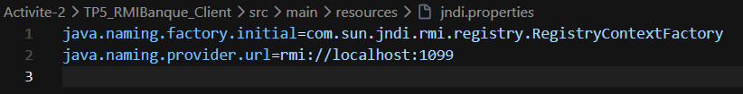

# TP5 – Activité 5-2 : Service bancaire (Java RMI + JNDI)

## Objectif

Un serveur RMI central gère des **comptes bancaires**. Les clients peuvent :

- **créer** un compte (code + solde initial), refusé si le code existe déjà ;
- **consulter** un compte à partir de son code.

Un `Compte` a un `code` (int), un `solde` (double) et une `dateCreation` (Date). 

On utilise ensuite **JNDI** pour publier et chercher l'objet distant, à la place de `Naming`.

## Étape 2 – Développement du serveur

**1. Classe `Compte`** (package `metier`) : elle implémente `Serializable`, sinon elle ne peut pas être envoyée par le réseau au serveur.

**2. Interface `IBanque`** : deux méthodes distantes, `creerCompte(Compte)` et `getInfoCompte(int)`.

**3. Implémentation `BanqueImpl`** : stocke les comptes dans une `ConcurrentHashMap` (clé = code). `putIfAbsent` empêche de créer deux fois le même code.

**4. Serveur `BanqueServer`** (avec JNDI).

## Étape 3 – Développement du client

**1. Générer `banqueClient.jar`** : dans le `pom.xml` du serveur, seuls `IBanque` et `Compte` sont inclus (pas `BanqueImpl`).

**2. Importer le JAR dans le client** : via une dépendance Maven vers le projet serveur.

**3. Client `BanqueClient`** : crée les comptes 1 et 2, retente le compte 1 (doit échouer), puis consulte les comptes 1, 2 et 99.

## Étape 5 – JNDI à la place de `Naming`

**JNDI** est une API standard d'annuaire. Au lieu de `Naming.rebind/lookup` avec une URL, on utilise `InitialContext` et la configuration est dans un fichier `jndi.properties` (dans `src/main/resources`, côté serveur **et** client) :

**Résultat après relance avec JNDI.** Serveur démarré :

Client : les 2 comptes sont créés, le doublon est refusé, le compte 99 est introuvable.

